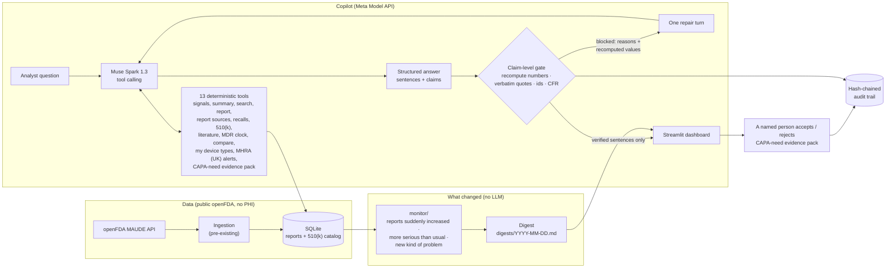

# MaudeSignal

[](https://github.com/kondapallysaicharan63-bot/maudesignal/actions/workflows/ci.yml)
[](https://www.python.org/downloads/)
[](LICENSE)

**Every morning, MaudeSignal shows where reports suddenly increased, where they are more serious than usual and where there is a new kind of problem, for the device types you choose — your competitors' devices and reports about your device you didn't file. It only shows facts it can match to the FDA record. People make every decision.**

> **What this is:** a B2B tool for postmarket-surveillance (PMS) and
> regulatory-affairs teams at medical-device makers, working on public openFDA
> MAUDE adverse-event data.
> **What it is not:** medical advice, clinical decision support, or an
> FDA-cleared device. It never decides whether an event is reportable or
> whether a CAPA is needed, and it does not define "similar devices": it works
> on the device types you choose.
> **People decide:** whether a CAPA is required is decided by the company's own
> CAPA-need form; MaudeSignal prepares evidence only, and a named person accepts
> it. Nothing is filed with FDA automatically.

Validation facts (what is deterministic, what a model writes, what is tested,
what a manufacturer would still do): [docs/VALIDATION_EVIDENCE.md](docs/VALIDATION_EVIDENCE.md).

---

## The problem

- Device makers already know their own complaints: they file them. What is
  hard to see is what happens to **other companies' devices of the same type**
  and the reports about **their own device filed by someone else** — a user
  facility such as a hospital, a voluntary reporter, a distributor. Those sit
  among tens of thousands of public MAUDE reports. openFDA's counts by report
  source for the demo device types are in
  [docs/hackathon/SOURCE_COUNTS.md](docs/hackathon/SOURCE_COUNTS.md).
- Reading MAUDE by hand is slow; a general-purpose chatbot is faster but can
  make up numbers, quotes and regulation citations, which a regulated
  workflow cannot accept.

## What it does (Monday morning)

1. **What changed this week.** A deterministic monitor (no model) compares
   the last 7 days of openFDA reports with the 4 weeks before, for the device
   types (FDA product codes) you choose, and flags three things: **reports
   suddenly increased**, **more serious than usual**, or a **new kind of
   problem**. On the demo data: *"LLZ: reports suddenly increased — 33 this
   week vs a weekly mean of 8.75 (3.77x)"*
   ([digests/2026-08-31.md](digests/2026-08-31.md)), with the reason it is
   ranked first.
2. **Any device type, live.** Type any FDA product code on the Signals page:
   MaudeSignal asks openFDA for counts (about 5 requests, no report text,
   nothing stored, no model) and applies the same four rules, with a link to
   the openFDA query behind every figure. A weekly GitHub Actions job runs the
   same check for every product code on FDA's AI-Enabled Medical Device List
   ([docs/hackathon/AI_SWEEP.md](docs/hackathon/AI_SWEEP.md)).
3. **Who filed the reports.** Counts per device type by openFDA report source
   (manufacturer, user facility, voluntary, distributor) and a filterable list
   of the reports **not filed by a manufacturer**. On the demo data all 33 LLZ
   reports this week, and all 121 LLZ reports in the stored demo sample, were filed by
   manufacturers (openFDA as a whole: 19,970 LLZ reports, 99.3% manufacturer-filed); the
   non-manufacturer reports on file are 3 MYN, 3 QIH and 1 POK (all voluntary).
4. **Ask the copilot,** typed or by voice. Muse Spark calls 13 tools over
   stored MAUDE reports, FDA recalls, 510(k) records and PubMed abstracts and
   answers in a strict JSON schema: sentences, each tagged with the claims it
   makes.
5. **The gate checks every claim.** A made-up quote or count is withheld with
   the reason (*"claimed 500, records show 121"*); a reply that does not parse
   is withheld too. The model gets one repair turn with the gate's values.
6. **CAPA-need evidence pack.** The copilot can prepare the evidence (the
   supporting reports and a problem statement); a named person accepts or
   rejects it in the Signals workspace (Evidence pack tab); the Audit page keeps the trail. The model cannot.
7. **Evidence pack (PDF).** *Signal Evaluation & CAPA-need Evidence*, laid out
   like a controlled quality record: document control, signal evaluation,
   evidence table, the ISO 13485:2016 §8.5.2 sections left blank for the CAPA
   owner, an MDR worksheet mapped to FDA Form 3500A (stamped *not for
   submission*) and the audit trail. Every printed number is re-verified by the
   gate. **Muse Wonder 1.0** reviews the whole PDF before a person accepts it.
8. **Vision.** Muse Spark reads FDA 510(k) summary PDFs (many are scanned)
   twice, independently; a field is *verified* only if both reads agree and
   openFDA / the PDF text layer agree, otherwise it is flagged for a person.
   A photo of a device label → **SAM 3.1** finds the label → Muse Spark reads
   it → the K-number is checked against FDA.
9. **Audit trail.** Every answer, spoken question, live-call cost and decision
   is appended to a SHA-256 hash-chained log; the dashboard re-verifies it.

## How it's different

Other tools summarize MAUDE with AI and add a review step — for example
[DeviceWatch](https://devicewatch.app/data) (AI summaries of MAUDE records;
public pricing from $499/month),
[Basil Systems](https://www.businesswire.com/news/home/20251006297490/en/Basil-Systems-Launches-Safety-Signaling-Solution-to-Proactively-Detect-and-Prevent-Medical-Device-Risks)
(AI safety signaling across regulatory and adverse-event records) and
[Complizen](https://www.complizen.ai/platform) (AI answers drawing on FDA
guidance, 510(k) history and MAUDE). MaudeSignal differs in three ways:

- **It withholds what it cannot match.** Every number is recomputed, every
  quote matched word for word, every report id, 510(k), recall, PMID and CFR
  section checked against stored FDA records — or the sentence is not shown.
  Adversarial set: 112 cases, 0 false passes, 0 false blocks.
- **It reads scanned 510(k) documents with a two-read accuracy check.**
- **It is open source and self-hostable** (MIT), on public FDA data only.

[BEUDAMED](https://beudamed.com/psur-reports) is also worth knowing: it describes
itself as a free tool with no AI, where you enter a product code and get charts
plus a methodology. MaudeSignal differs plainly: an agent can run the
investigation for a device type the weekly check flagged, or for a given recall
(run on request; recordings pending). Every fact it writes is matched to the
stored source record (FDA, MHRA or literature) or withheld, and the search
protocol behind each answer (dataset, filters, dates, counts) is written down
so a person can repeat it.

### Three agentic workflows (status)

| Workflow | Command | Status |
|---|---|---|
| Weekly investigator: for a device type the weekly check flagged, Muse Spark pulls the new reports, groups them by kind of problem, checks recalls, 510(k)s and non-manufacturer reports, and writes the digest entry through the gate | `maudesignal investigate` | Built and tested with mocked model calls (`tests/unit/test_weekly_investigator.py`). One real recording is stored: `demo/investigations/20261030T010942Z-weekly-llz.json` (LLZ; 7 of 7 sentences and 9 of 9 claims passed the gate on the first pass; $0.224989). |
| Recall-triggered sweep: Muse Spark reads a recall's reason and searches stored narratives for the same problem; quotes matched word for word, counts recomputed by the gate | `maudesignal recall-sweep` | Built and tested with mocked model calls (`tests/unit/test_recall_sweep.py`). Real recordings pending. |
| Search protocol: every tool call's dataset, filters, dates and counts, listed as a search-methodology appendix in the evidence-pack PDF | part of the dossier build | Built and tested (`tests/unit/test_search_protocol.py`). |

Recordings of the first two run in GitHub Actions
(`.github/workflows/investigator-record.yml`) with the repository's model key;
until a recording is committed, nothing here is shown as a real run.

## Real-run numbers (2026-10-28, fifth recording)

From [`demo/transcripts/`](demo/transcripts/), [`demo/vision/`](demo/vision/),
[`demo/dossier/`](demo/dossier/) and the hand-check
[`docs/hackathon/HAND_CHECK.md`](docs/hackathon/HAND_CHECK.md):

| | |
|---|---|
| Recording run | GitHub Actions run 40764365995 (fifth recording, 2026-10-28): 28 copilot answers (22 typed, 6 text-to-speech clips, mostly not shown in the app any more) |
| Gate, first pass | 63/65 sentences passed (96.9%); after one repair turn: 64/65 (one true sentence wrongly withheld — a year read as a count; fixed in the gate since) |
| Replies that never parsed | 0 of 28; 0 answers stopped by the token cap |
| Hand-check | **27 of 28 answers fully correct (96.4%)**; typed 21 of 22, text-to-speech clips 6 of 6. Of 65 sentences: 64 correct, 1 incomplete (the wrongly withheld one); none wrong. Checked against the demo database by Claude; an independent check by Charan is pending. Earlier recordings: 24/24, 21/24, 19/21, 6/21 |
| Cost per answer | $0.0454 (28 answers, $1.2717) |
| 510(k) reading | **5 of 5 summaries read**: the two reads agree on 100% of fields for K031779, 90% for K190442, K210666 and K261677, and 80% for K043333; the 6 conflicting fields are flagged for a person, never guessed |
| Label camera (SAM 3.1 + Muse Spark) | **7 of 7 photos read**: 4 devices read correctly (CareSens N, HoMedics thermometer ×2, Welch Allyn 802 LTR), thermometers matched to FDA product code FLL; 1 left for a person to pick; 1 returned nothing (rotated label); 1 misread (Welch module: wrong text, every field marked only partly legible, no product code); no lot/serial stored |
| Evidence pack (PDF) | Muse Spark summary: 5 sentences shown, 0 withheld, in plain words (no "spike"); Muse Wonder review: 0 findings (the previous recording had 2, a high one on section 4.1 and a medium one on the section 4 title; both fixed by the reword). Recorded 2026-10-31 for the current pack (SER-LLZ-20260831-001) |
| Report sources vs openFDA | 0 mismatches |

Oct-29 voice run (GitHub Actions run 40965201781, 3 answers, stored in the repo
alongside the fifth recording; the table above stays the fifth recording's): the gate passed
8 of 8 sentences, first pass and final. All 8 sentences were hand-checked against the demo
database by Claude (8 correct, 0 wrong); an independent check by Charan is pending.

Spoken questions: the spoken questions the app and the walkthrough show are Charan's own
recordings, public with his consent (`demo/voice/question-take1.wav`, `-take4.wav`,
`-take6.wav`). They were not heard word for word: Voice Transcribe wrote "LLG" and "LLC"
for LLZ and added stray words ("devices? devices?", "week. week."). The product code is
corrected by a fixed one-letter rule (`src/maudesignal/copilot/product_code.py`), and the
screen states it ("Heard LLG -> did you mean LLZ? The answer used LLZ (one letter
different; the only close code on file)."); the heard text is kept next to the question.
The correction is never silent: in live mode the analyst confirms it before anything is sent,
and the stored demo shows both codes and says which one the recorded answer used. Take 4 is the "50 injury reports" trap
the copilot rejects: 33 reports, 0 injuries (in the stored demo sample). Take 6's answer, "all 121 stored LLZ
reports were filed by a manufacturer", is about the stored demo sample of 121 LLZ reports,
not openFDA as a whole (19,970 LLZ reports, 99.3% manufacturer-filed). The earlier
text-to-speech clips (ElevenLabs, not a person) are kept only in the audit trail, except
one question (`question-d`) that no recording of Charan's covers. The one incomplete
answer (06-trap) lost a true sentence because the gate read "August 31, 2026,
all malfunction" as a count of 2026; the gate now treats a year after a month
as a date (adversarial cases dt03–dt05).

## Pilot and pricing

- **Buyer:** PMS / RA teams at small and mid-size device makers.
- **Open source, self-hosted:** free.
- **Hosted plan:** priced in the range practitioners we spoke to quoted,
  about $200–300/month, against existing tools from $499/month.
- **Pilot metric:** time to prepare the signal-evidence section for the device types you choose
  in a PMS report, with and without MaudeSignal.

## Tomorrow

- Team accounts / SSO (not built: today it is a public demo key plus personal keys, no logins)
- A shared Upstash store, so rate limits, caches and the audit log are shared by every API
  instance (supported by the code, not turned on for the public copy)
- More regulators: only after a scope review (today FDA / openFDA, plus MHRA (UK) alerts shown as
  labelled context)

## How Meta AI is used

| Step | Meta model / API | Why |
|---|---|---|
| Answering a question | **Muse Spark 1.3** (`muse-spark-1.3`) via the **Meta Model API** (OpenAI-compatible, `https://api.meta.ai/v1`) | Tool calling over 13 deterministic tools; **strict `json_schema` structured output** (sentences + typed claims, [`skills/safety-copilot`](skills/safety-copilot/SKILL.md)); a **repair turn** after a gate block, fed the gate's reasons and recomputed values |
| Reading scanned FDA documents | **Muse Spark 1.3 image understanding** ([`skills/fda-document-reader`](skills/fda-document-reader/SKILL.md)) | 510(k) summary pages → structured fields with per-field legibility; two independent reads + openFDA + text layer decide VERIFIED / CONFLICT / UNVERIFIABLE |
| Device-label camera | **SAM 3.1** (`sam-3.1`) + **Muse Spark 1.3 vision** | SAM locates the label in the photo, Spark reads the crop, the K-number / GTIN is checked against FDA |
| Dossier narrative | **Muse Spark 1.3** ([`skills/dossier-narrative`](skills/dossier-narrative/SKILL.md)) | One-page summary drafted as claims and passed through the gate |
| Independent reviewer | **Muse Wonder 1.0** (`muse-wonder-1.0`, PDF input, 1M context) | Reads the full dossier PDF + cited reports and lists unsupported or contradicted statements before a person accepts the evidence; never edits the record |
| Cover illustration (optional, off by default) | **Muse Image 1.0** | Non-evidentiary cover art, captioned "AI-generated illustration — not evidence"; never inside evidence sections |
| Spoken questions | **Meta Voice Transcribe** (`muse-voice-transcribe-1.0`) | Ask by voice; only the transcript text reaches Muse Spark, and it goes through the same copilot and gate |
| Recording the public demo | All of the above in GitHub Actions ([`copilot-record.yml`](.github/workflows/copilot-record.yml)), key from repository secrets | The public, keyless app replays real runs instead of mocked ones |

**Muse connector** (read-only MCP + REST at `https://maudesignal-api.vercel.app/mcp`): Submitted to Meta's Muse Connector Program — pending review. Form answers: [docs/hackathon/MUSE_CONNECTOR.md](docs/hackathon/MUSE_CONNECTOR.md).

**Standard tier only.** Never the Contributor tier, which trains on your data.
The key is read from `META_MODEL_API_KEY`, never committed or logged.

## Architecture



Source: [docs/architecture.mmd](docs/architecture.mmd) · rendered:
[docs/architecture.svg](docs/architecture.svg)

## The citation gate

[`src/maudesignal/gate/`](src/maudesignal/gate/) is deterministic and makes no
model calls. For every sentence the copilot wants to show:

- **counts** are recomputed from stored records and must match exactly;
  **shares** must be within 0.5 percentage points;
- **quotes** must appear verbatim in the narrative of the report they are
  attributed to (a real quote pinned to the wrong report is blocked);
- **510(k) numbers** must exist in the catalog or stored openFDA 510(k)
  records and match the stated product code / device name; **MAUDE report
  ids**, **FDA recall numbers** and **PubMed PMIDs** must exist in stored data
  (and match the stated product code / year); recall counts are recomputed;
- **21 CFR sections** must be on a curated allowlist; QS-reg sections
  superseded by QMSR on 2026-02-02 are blocked with the reason;
- **report-source counts** (who filed the reports) are recomputed from the
  stored openFDA `report_source_code`;
- a sentence that mentions a number, K-number, report id or CFR section
  **without** a matching structured claim is blocked as ungrounded.

**Adversarial test set:** [112 cases](tests/fixtures/gate/adversarial.jsonl)
(70 must block, 42 must pass): fabricated and drifted quotes, real quotes on
the wrong report, stale / inflated counts, wrong shares, fake and mismatched
K-numbers, hallucinated and superseded CFR sections, fake recall numbers and
PMIDs, real ones on the wrong product or year, wrong report-source counts,
untagged mentions (including "N hospital reports"), dates that look like counts,
and counts written in words or scientific notation ("thirty-three reports", "1e3 reports").
Result: **0 false passes, 0 false blocks**
([`tests/unit/test_gate.py`](tests/unit/test_gate.py), 129 tests).

Real verdicts on the demo database (137 MAUDE reports):

| Sentence / claim | Verdict |
|---|---|
| Quote taken from report 25675105, attributed to 25675105 | ✅ pass |
| The same quote attributed to report 25675201 | ⛔ `quote is real but belongs to 25675105, not 25675201` |
| "the AI failed to flag the hemorrhage" attributed to 25675105 | ⛔ `quote not found verbatim in 25675105` |
| "LLZ had 500 reports" | ⛔ `claimed 500, records show 121` |
| "Open a CAPA under 21 CFR 820.100" | ⛔ `superseded by QMSR (ISO 13485 clauses 8.5.2/8.5.3) on 2026-02-02` |
| "About 40% of LLZ reports were malfunctions" (no claim attached) | ⛔ `ungrounded: 40% has no share claim` |

## Quickstart (about 2 minutes, no API key)

```bash
git clone https://github.com/kondapallysaicharan63-bot/maudesignal.git
cd maudesignal
python3.12 -m venv .venv && source .venv/bin/activate
pip install -e .

# What-changed digest from the committed demo database (no network, no LLM)
maudesignal monitor --no-fetch

# Dashboard on the demo database: Signals, Copilot, Vision, Audit
streamlit run streamlit_app.py
```

The demo database ([`data/demo/maudesignal_demo.db`](data/demo/)) holds 137
real MAUDE reports fetched without a key from openFDA (LLZ complete for
Jul–Aug 2026; all QIH, MYN and POK reports). The exact queries are in
[`SEED_MANIFEST.json`](data/demo/SEED_MANIFEST.json). With no
`MAUDESIGNAL_DB_PATH` set and no local `data/maudesignal.db`, the dashboard
opens this database automatically. Without a key, the Copilot page replays
recorded Muse Spark runs (from [`demo/transcripts/`](demo/), once recorded)
and lets you try to fool the gate live. Set `META_MODEL_API_KEY` to ask live
questions.

**Live demo:** <https://maudesignal-4vniqswm9ptaxqtf2iawox.streamlit.app/>

**Deploy (Streamlit Community Cloud):** entry point `streamlit_app.py`,
dependencies from `requirements.txt`, no secrets required.

## Deploy your own copy

[](https://vercel.com/new/clone?repository-url=https://github.com/kondapallysaicharan63-bot/maudesignal&project-name=maudesignal-web&root-directory=web&env=VITE_MAUDESIGNAL_API_BASE&envDescription=Base%20URL%20of%20your%20own%20MaudeSignal%20API%20project)

Two Vercel projects from the same repository: the website (`web/`) and the read-only API
(repository root, `api/index.py`). Nothing is deployed for you and no key is in the repository.

1. **Website.** Click the button above (root directory `web`, framework Vite). Set
   `VITE_MAUDESIGNAL_API_BASE` to your API project's URL once step 2 exists. Left empty, the
   website still shows the stored data; live chat, voice, camera and outside mentions then use
   recorded runs.
2. **API.** Import the same repository a second time with the root directory left at the
   repository root. Add these environment variables in Project > Settings > Environment Variables:
   `MAUDESIGNAL_API_KEYS` (a key you generate, as `label=KEY`), `MAUDESIGNAL_KEY_PEPPER` (a long
   random string), `MAUDESIGNAL_WEB_ORIGINS` (your website URL), `OPENFDA_API_KEY` (optional, higher
   openFDA quota). Leave `META_MODEL_API_KEY` unset to answer from recorded runs; set it, together
   with a private Blob store (`BLOB_READ_WRITE_TOKEN`), only when you accept the cost: every Meta
   call is held to a daily ceiling (`MAUDESIGNAL_LIVE_DAILY_USD`, default $3.00).
3. **Check it.** Open `<your API URL>/v1/health`, then `<your API URL>/docs-page`; add
   `<your API URL>/mcp` to your MCP client with your key (the website's Connect page shows config
   snippets). Turn Vercel Authentication off for production so visitors do not meet a login page.

Full variable list and limits: [`docs/hackathon/MUSE_CONNECTOR.md`](docs/hackathon/MUSE_CONNECTOR.md).

## Built during the hackathon vs pre-existing

Built during the Meta Global AI Developer Hackathon (Oct 26 – Nov 4, 2026):
the copilot, the citation gate, the daily what-changed monitor and report-source
filter, the product pages (the Signals workspace, Copilot, Vision, Audit), voice questions, the evidence-pack PDF, the CAPA-need
evidence and audit tables, the live-call spend caps and the keyless demo deploy. The
openFDA pipeline below predates the event. The file-by-file list is in
[HACKATHON.md](HACKATHON.md).

## Tests

**1147 unit tests pass, 78% line + branch coverage** (2026-10-30); all 21 test types
are reported in [docs/hackathon/TESTING.md](docs/hackathon/TESTING.md)
(`pytest tests/unit`; CI also runs ruff, black and `mypy --strict` on Python
3.11 and 3.12).

```bash
pip install -e ".[dev]"
pytest tests/unit
ruff check . && black --check . && mypy src/maudesignal
```

---

## Pipeline (pre-existing)

The base `maudesignal` pipeline: ingest MAUDE reports from openFDA, extract
structured fields with an LLM, triage severity, classify into an 11-category
AI failure taxonomy, cluster root causes, detect trends (Mann-Kendall + linear
regression) and drift (KS / PSI), pull PubMed and ClinicalTrials.gov sources,
and draft a PSUR-style report (Markdown + optional PDF). LLM behaviour lives in
versioned Skills (`skills/<name>/SKILL.md` + JSON Schema + good/bad examples),
never in inline strings. The extraction layer is provider-agnostic: Groq
(default), Anthropic, OpenAI, Gemini, or a multi-key `pool` that rotates on
rate limits.

| Skill | Version | Purpose |
|---|---|---|
| [`safety-copilot`](skills/safety-copilot/SKILL.md) | v1.0.0 | **Hackathon.** Copilot behaviour contract: tools, structured claims, advisory-only rules |
| [`regulatory-citation-verifier`](skills/regulatory-citation-verifier/SKILL.md) | v1.0.0 | Citation rules; enforced in code by `gate/` (hackathon) |
| [`maude-narrative-extractor`](skills/maude-narrative-extractor/SKILL.md) | v1.0.0 | Structured fields from MAUDE narratives |
| [`severity-triage`](skills/severity-triage/SKILL.md) | v1.0.0 | Death / serious injury / malfunction / other |
| [`ai-failure-mode-classifier`](skills/ai-failure-mode-classifier/SKILL.md) | v1.0.0 | 11-category AI failure taxonomy |
| [`root-cause-analyzer`](skills/root-cause-analyzer/SKILL.md) | v1.0.0 | Root-cause hypothesis per failure-mode cluster |
| [`drift-analysis-interpreter`](skills/drift-analysis-interpreter/SKILL.md) | v1.0.0 | KS/PSI statistics → regulatory language |
| [`trend-interpreter`](skills/trend-interpreter/SKILL.md) | v1.0.0 | Trend statistics → regulatory narrative |
| [`psur-report-drafter`](skills/psur-report-drafter/SKILL.md) | v1.1.0 | PSUR draft with signal assessment |

### Running the pipeline (needs an LLM key for the extraction steps)

```bash
cp .env.example .env            # e.g. LLM_PROVIDER=groq and GROQ_API_KEY=...

maudesignal ingest --product-code QIH --limit 20      # openFDA → SQLite
maudesignal catalog update                            # FDA AI/ML device catalog
maudesignal extract --product-code QIH --limit 10     # extract → triage → classify
maudesignal analyze root-cause --product-code QIH
maudesignal alert check --product-code QIH
maudesignal forecast trends QIH
maudesignal drift --product-code QIH
maudesignal sources fetch pubmed --query "AI radiology device failure" --product-code QIH
maudesignal psur generate QIH --device-name "AI Radiology CAD" --output reports/QIH_psur.pdf
maudesignal status
```

`maudesignal --help` lists every command. PDF export needs the system
libraries WeasyPrint uses (Pango/Cairo); without them the PDF step is skipped
and Markdown is still produced.

### Documentation

| | |
|---|---|
| Hackathon build manifest | [HACKATHON.md](HACKATHON.md) |
| Vision & non-goals | [docs/01_vision_mission.md](docs/01_vision_mission.md) |
| Requirements | [docs/03_requirements_spec.md](docs/03_requirements_spec.md) |
| System design (pre-hackathon) | [docs/05_architecture.md](docs/05_architecture.md) |
| Pilot findings | [v1](docs/00_pilot_findings.md) · [v2](docs/00_pilot_findings_v2.md) · [v3](docs/00_pilot_findings_v3.md) |
| Repo conventions for AI assistants | [CLAUDE.md](CLAUDE.md) |
| Disclaimer | [DISCLAIMER.md](DISCLAIMER.md) |

## License

[MIT](LICENSE). openFDA data is public domain; see [DISCLAIMER.md](DISCLAIMER.md)
for the regulatory-use notice.

## Author

**Saicharan Kondapally**, M.S. Biomedical Engineering, San Jose State
University · [GitHub](https://github.com/kondapallysaicharan63-bot)
