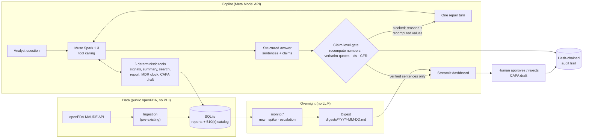

# MaudeSignal

[](https://github.com/kondapallysaicharan63-bot/maudesignal/actions/workflows/ci.yml)
[](https://www.python.org/downloads/)
[](LICENSE)

**A Muse Spark safety copilot for medical-device QA/RA teams that cannot state a number, quote, device id or CFR section it can't prove from public FDA records.**

> **What this is:** a B2B regulatory triage aid for quality / regulatory-affairs
> analysts at AI/ML medical-device makers, working on public openFDA MAUDE
> adverse-event data.
> **What it is not:** medical advice, clinical decision support, or an
> FDA-cleared device.
> **Human in the loop:** every action is a draft that a named human approves.
> Nothing is filed with FDA automatically.

---

## The problem

- A device maker that learns of a death or serious injury its device may have
  caused or contributed to must file a medical device report **no later than
  30 calendar days** after becoming aware
  ([21 CFR 803.50(a)](https://www.ecfr.gov/current/title-21/chapter-I/subchapter-H/part-803/subpart-E/section-803.50)).
- Those deadlines are often missed. A cross-sectional study in *The BMJ*
  (Oct 2026) of the FDA's adverse-event database found that **55% of 6,308
  summary reports** (bulk reports that bundle many events; together 159,503
  events, July 2019 – June 2025) **exceeded the 30-day deadline**
  ([doi:10.1136/bmj-2026-100812](https://doi.org/10.1136/bmj-2026-100812);
  [BMJ press release](https://bmjgroup.com/?p=18426)).
- Analysts triage MAUDE by hand: read narratives, count reports, check the
  clock. A general-purpose chatbot speeds that up but can make up numbers,
  quotes and regulation citations, which is not acceptable in a regulated
  workflow.

## What it does in 60 seconds (Monday morning)

1. **Overnight digest.** A deterministic monitor (no LLM) compares the last 7
   days of openFDA reports with a trailing 4-week baseline per product code.
   On the demo data: *"0 new, 1 worsening — LLZ: volume spike (33 this week vs
   a weekly mean of 8.75)"* ([digests/2026-08-31.md](digests/2026-08-31.md)).
2. **Ask the copilot.** *"What got worse for LLZ this week, and what do the
   reports say?"* Muse Spark 1.3 calls 6 tools over the stored records and
   answers as sentences, each tagged with the claims it makes.
3. **The gate checks every claim.** A made-up quote is withheld with the
   reason (*"quote not found verbatim in 25675105"*). A true quote passes and
   links to the MAUDE report it came from. If anything is blocked, the model
   gets one repair turn with the gate's recomputed values.
4. **MDR deadline clock.** From the awareness date: 30 calendar days
   (21 CFR 803.50) or 5 work days (21 CFR 803.53). Advisory: whether to report
   is a human decision.
5. **CAPA draft.** The copilot can only create a *draft*. A named human
   approves or rejects it on the Actions page; the model cannot.
6. **Audit trail.** Every answer and decision is appended to a SHA-256
   hash-chained log; the dashboard verifies the chain and detects tampering.

## How Meta AI is used

| Step | Meta model / API | Why |
|---|---|---|
| Answering a question | **Muse Spark 1.3** (`muse-spark-1.3`) via the **Meta Model API** (OpenAI-compatible, `https://api.meta.ai/v1`) | Tool calling over 6 deterministic tools; structured output (sentences + typed claims, [`skills/safety-copilot`](skills/safety-copilot/SKILL.md)); a **repair turn** after a gate block, fed the gate's reasons and recomputed values |
| Spoken questions | **Meta Voice Transcribe** (`muse-voice-transcribe-1.0`) | Ask by voice; only the transcript text reaches Muse Spark, and it goes through the same copilot and gate |
| Recording the public demo | Muse Spark 1.3 in GitHub Actions ([`copilot-record.yml`](.github/workflows/copilot-record.yml)), key from repository secrets | The public, keyless app replays real runs instead of mocked ones |

**Standard tier only.** Never the Contributor tier, which trains on your data.
The key is read from `META_MODEL_API_KEY`, never committed or logged.

## Architecture



Source: [docs/architecture.mmd](docs/architecture.mmd) · rendered:
[docs/architecture.svg](docs/architecture.svg)

## The citation gate

[`src/maudesignal/gate/`](src/maudesignal/gate/) is deterministic and makes no
model calls. For every sentence the copilot wants to show:

- **counts** are recomputed from stored records and must match exactly;
  **shares** must be within 0.5 percentage points;
- **quotes** must appear verbatim in the narrative of the report they are
  attributed to (a real quote pinned to the wrong report is blocked);
- **510(k) numbers** must exist in the catalog and match the stated product
  code / device name; **MAUDE report ids** must exist;
- **21 CFR sections** must be on a curated allowlist; QS-reg sections
  superseded by QMSR on 2026-02-02 are blocked with the reason;
- a sentence that mentions a number, K-number, report id or CFR section
  **without** a matching structured claim is blocked as ungrounded.

**Adversarial test set:** [54 cases](tests/fixtures/gate/adversarial.jsonl)
(33 must block, 21 must pass): fabricated and drifted quotes, real quotes on
the wrong report, stale / inflated counts, wrong shares, fake and mismatched
K-numbers, hallucinated and superseded CFR sections, untagged mentions.
Result: **0 false passes, 0 false blocks**
([`tests/unit/test_gate.py`](tests/unit/test_gate.py), 63 tests).

Real verdicts on the demo database (137 MAUDE reports):

| Sentence / claim | Verdict |
|---|---|
| Quote taken from report 25675105, attributed to 25675105 | ✅ pass |
| The same quote attributed to report 25675201 | ⛔ `quote is real but belongs to 25675105, not 25675201` |
| "the AI failed to flag the hemorrhage" attributed to 25675105 | ⛔ `quote not found verbatim in 25675105` |
| "LLZ had 500 reports" | ⛔ `claimed 500, records show 121` |
| "Open a CAPA under 21 CFR 820.100" | ⛔ `superseded by QMSR (ISO 13485 clauses 8.5.2/8.5.3) on 2026-02-02` |
| "About 40% of LLZ reports were malfunctions" (no claim attached) | ⛔ `ungrounded: 40% has no share claim` |

## Quickstart (about 2 minutes, no API key)

```bash
git clone https://github.com/kondapallysaicharan63-bot/maudesignal.git
cd maudesignal
python3.12 -m venv .venv && source .venv/bin/activate
pip install -e .

# Overnight digest from the committed demo database (no network, no LLM)
maudesignal monitor --no-fetch

# Dashboard on the demo database: Overnight, Copilot, Actions & Audit pages
streamlit run streamlit_app.py
```

The demo database ([`data/demo/maudesignal_demo.db`](data/demo/)) holds 137
real MAUDE reports fetched without a key from openFDA (LLZ complete for
Jul–Aug 2026; all QIH, MYN and POK reports). The exact queries are in
[`SEED_MANIFEST.json`](data/demo/SEED_MANIFEST.json). With no
`MAUDESIGNAL_DB_PATH` set and no local `data/maudesignal.db`, the dashboard
opens this database automatically. Without a key, the Copilot page replays
recorded Muse Spark runs (from [`demo/transcripts/`](demo/), once recorded)
and lets you try to fool the gate live. Set `META_MODEL_API_KEY` to ask live
questions.

**Deploy (Streamlit Community Cloud):** entry point `streamlit_app.py`,
dependencies from `requirements.txt`, no secrets required.

## Built during the hackathon vs pre-existing

Built during the Meta Global AI Developer Hackathon (Oct 26 – Nov 4, 2026):
the copilot, the citation gate, the overnight monitor, the three new
dashboard pages, the CAPA/audit tables and the keyless demo deploy. The
openFDA pipeline below predates the event. The file-by-file list is in
[HACKATHON.md](HACKATHON.md).

## Tests

**324 unit tests pass, 64.7% line + branch coverage**
(`pytest tests/unit`; CI also runs ruff, black and `mypy --strict` on Python
3.11 and 3.12).

```bash
pip install -e ".[dev]"
pytest tests/unit
ruff check . && black --check . && mypy src/maudesignal
```

---

## Pipeline (pre-existing)

The base `maudesignal` pipeline: ingest MAUDE reports from openFDA, extract
structured fields with an LLM, triage severity, classify into an 11-category
AI failure taxonomy, cluster root causes, detect trends (Mann-Kendall + linear
regression) and drift (KS / PSI), pull PubMed and ClinicalTrials.gov sources,
and draft a PSUR-style report (Markdown + optional PDF). LLM behaviour lives in
versioned Skills (`skills/<name>/SKILL.md` + JSON Schema + good/bad examples),
never in inline strings. The extraction layer is provider-agnostic: Groq
(default), Anthropic, OpenAI, Gemini, or a multi-key `pool` that rotates on
rate limits.

| Skill | Version | Purpose |
|---|---|---|
| [`safety-copilot`](skills/safety-copilot/SKILL.md) | v1.0.0 | **Hackathon.** Copilot behaviour contract: tools, structured claims, advisory-only rules |
| [`regulatory-citation-verifier`](skills/regulatory-citation-verifier/SKILL.md) | v1.0.0 | Citation rules; enforced in code by `gate/` (hackathon) |
| [`maude-narrative-extractor`](skills/maude-narrative-extractor/SKILL.md) | v1.0.0 | Structured fields from MAUDE narratives |
| [`severity-triage`](skills/severity-triage/SKILL.md) | v1.0.0 | Death / serious injury / malfunction / other |
| [`ai-failure-mode-classifier`](skills/ai-failure-mode-classifier/SKILL.md) | v1.0.0 | 11-category AI failure taxonomy |
| [`root-cause-analyzer`](skills/root-cause-analyzer/SKILL.md) | v1.0.0 | Root-cause hypothesis per failure-mode cluster |
| [`drift-analysis-interpreter`](skills/drift-analysis-interpreter/SKILL.md) | v1.0.0 | KS/PSI statistics → regulatory language |
| [`trend-interpreter`](skills/trend-interpreter/SKILL.md) | v1.0.0 | Trend statistics → regulatory narrative |
| [`psur-report-drafter`](skills/psur-report-drafter/SKILL.md) | v1.1.0 | PSUR draft with signal assessment |

### Running the pipeline (needs an LLM key for the extraction steps)

```bash
cp .env.example .env            # e.g. LLM_PROVIDER=groq and GROQ_API_KEY=...

maudesignal ingest --product-code QIH --limit 20      # openFDA → SQLite
maudesignal catalog update                            # FDA AI/ML device catalog
maudesignal extract --product-code QIH --limit 10     # extract → triage → classify
maudesignal analyze root-cause --product-code QIH
maudesignal alert check --product-code QIH
maudesignal forecast trends QIH
maudesignal drift --product-code QIH
maudesignal sources fetch pubmed --query "AI radiology device failure" --product-code QIH
maudesignal psur generate QIH --device-name "AI Radiology CAD" --output reports/QIH_psur.pdf
maudesignal status
```

`maudesignal --help` lists every command. PDF export needs the system
libraries WeasyPrint uses (Pango/Cairo); without them the PDF step is skipped
and Markdown is still produced.

### Documentation

| | |
|---|---|
| Hackathon build manifest | [HACKATHON.md](HACKATHON.md) |
| Vision & non-goals | [docs/01_vision_mission.md](docs/01_vision_mission.md) |
| Requirements | [docs/03_requirements_spec.md](docs/03_requirements_spec.md) |
| System design (pre-hackathon) | [docs/05_architecture.md](docs/05_architecture.md) |
| Pilot findings | [v1](docs/00_pilot_findings.md) · [v2](docs/00_pilot_findings_v2.md) · [v3](docs/00_pilot_findings_v3.md) |
| Repo conventions for AI assistants | [CLAUDE.md](CLAUDE.md) |
| Disclaimer | [DISCLAIMER.md](DISCLAIMER.md) |

## License

[MIT](LICENSE). openFDA data is public domain; see [DISCLAIMER.md](DISCLAIMER.md)
for the regulatory-use notice.

## Author

**Saicharan Kondapally**, M.S. Biomedical Engineering, San Jose State
University · [GitHub](https://github.com/kondapallysaicharan63-bot)
